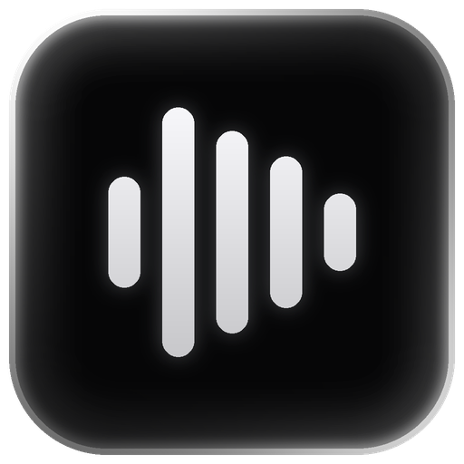

# Dictately

[](https://github.com/AlthafTM/dictately/releases/latest)
[](LICENSE)
[](#download-and-install)
[](https://github.com/AlthafTM/dictately/commits/main)
[](https://github.com/AlthafTM/dictately)
[](docs/DEVELOPMENT.md)

<p align="center">
  
</p>

**Local live dictation for Windows that turns your speech into text in the app you're using.**

Dictately turns **English** and **Indonesian** speech into text in your focused text field. Recognition runs on your computer, with no account or subscription. After setup, dictation works offline.

[Download for Windows](https://github.com/AlthafTM/dictately/releases/latest) · [User guide](docs/USER-GUIDE.md) · [How it works](docs/HOW-IT-WORKS.md)

[Security and reporting](SECURITY.md)

**How it works:** You speak into your microphone. Dictately recognizes your speech locally and types it into the text field you selected.

## Features

- Live text in short phrases as you speak
- **English** or **Indonesian**, with voice, click, scroll, and drag language selection
- Custom shortcuts, microphone selection, and six overlay positions
- Spoken corrections, personal vocabulary, and optional filler cleanup
- [Voice screenshots](docs/USER-GUIDE.md#voice-screenshots) with native crop controls
- A compact waveform UI and optional launch at sign-in

More languages may be supported later.

## Download and install

Requires **Windows 10/11 x64**, a microphone, and at least **8 GB free during setup**. An NVIDIA GPU is recommended; CPU mode is slower. The installer includes the runtime and is currently unsigned.

### Windows installer (recommended)

1. Open [the latest release](https://github.com/AlthafTM/dictately/releases/latest) and download **`Dictately-<version>-Setup.exe`** under **Assets**
2. Run the installer and choose an installation folder
3. Optionally enable **Start Dictately when I sign in to Windows**, then click **Install**
4. Wait for setup to install the runtime and download the speech model (about **1.6 GB**)
5. Open **Dictately** from the Start menu
6. Choose a language, click your text field, and start dictation using your configured shortcut

No separate Python or Rust installation is needed. If the download is interrupted, run setup again in the same folder to resume. Updates preserve your settings and history.

### Manual ZIP installation

1. If a Windows ZIP is provided in [Releases](https://github.com/AlthafTM/dictately/releases), download it and extract the entire archive to a permanent folder
2. Install [Python 3.12 for Windows](https://www.python.org/downloads/windows/), including the Python launcher and Tcl/Tk
3. Open PowerShell in the extracted folder and run one setup command:

   ```powershell
   # NVIDIA GPU
   .\scripts\windows\setup.ps1 -Gpu

   # CPU only
   .\scripts\windows\setup.ps1
   ```

4. Wait for dependencies and the model to finish downloading
5. Open **Dictately** from Start or double-click `launchers/windows/Start Dictately.vbs`

To enable sign-in startup during setup, add `-StartWithWindows`. Keep the extracted folder in place.

### Build from source

1. Install **Python 3.12** with the launcher and Tcl/Tk, [Rust](https://rust-lang.org/tools/install/), and the [Windows C++ build tools / Windows SDK](https://learn.microsoft.com/en-us/windows/dev-environment/rust/setup)
2. Clone the repository, or use **Code → Download ZIP** and extract it:

   ```powershell
   git clone https://github.com/AlthafTM/dictately.git
   cd dictately
   ```

3. Open **Developer PowerShell for Visual Studio** in the project folder and run:

   ```powershell
   .\scripts\windows\setup.ps1 -Gpu
   ```

   Omit `-Gpu` for CPU-only setup. Setup builds the Rust controller and downloads dependencies and model weights.

4. Launch **Dictately** from the Start menu

For later source updates, quit Dictately, pull changes, and rerun setup with `-Rebuild`.

### macOS and Linux

Follow the [step-by-step source setup guide](docs/MACOS-LINUX.md). These versions are experimental; Linux requires X11.

## How to use

1. Open the language picker and select **English** or **Indonesia** by voice, clicking, scrolling, or dragging
2. Click the text field where you want to type
3. Start dictation, speak normally, then stop to finish the last phrase

**Default shortcuts:** F12 for dictation, F10 for language selection. Change them in **Tray → Keyboard shortcuts**. Use **Tray → Audio & appearance** to choose a microphone or move the overlay.

Text appears in confirmed phrases rather than word by word. The first phrase can take longer while the model loads. Editor compatibility varies.

[Corrections and controls](docs/USER-GUIDE.md#how-to-use) · [Troubleshooting](docs/USER-GUIDE.md#settings-privacy-and-troubleshooting)

## Local AI and privacy

Dictately uses **OpenAI Whisper large-v3-turbo** through **faster-whisper / CTranslate2**. Small multilingual and Large-v3 are also supported. Speech stays on your device; transcript history is stored locally and can be cleared in settings.

[Choose an AI model](docs/AI-MODELS.md) · [Architecture, privacy, and limitations](docs/HOW-IT-WORKS.md)

## More information

- [Development and testing](docs/DEVELOPMENT.md)
- [Performance review](docs/PERFORMANCE-REVIEW.md)
- [Strengths, weaknesses, and Wispr Flow comparison](docs/WISPR-FLOW-COMPARISON.md)

## License

[MIT](LICENSE). You can use, fork, modify, and redistribute Dictately, keeping the license notice. Work in your own fork; changes to this repository require maintainer review. Dependencies and model weights retain their [own licenses](THIRD_PARTY.md).

<sub>***Made with AI assistance, but still maintained with periodic updates. Found a bug? [Report it](https://github.com/AlthafTM/dictately/issues).***</sub>
