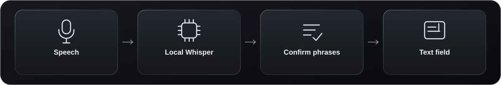

# Dictately

  

**Local live dictation with a clean, minimal UI.**

Dictately turns **English** and **Indonesian** speech into text in your focused text field. Recognition runs on your computer, with no account or subscription. After setup, dictation works offline.

[Download for Windows](https://github.com/AlthafTM/dictately/releases/latest) · [User guide](docs/USER-GUIDE.md) · [How it works](docs/HOW-IT-WORKS.md)

## Features

- Live text in short phrases as you speak
- **English**, **Indonesian**, or **Both**, selectable by voice or mouse
- Custom shortcuts, microphone selection, and six overlay positions
- Spoken corrections, personal vocabulary, and optional filler cleanup
- A compact waveform UI and optional launch at sign-in

More languages may be supported later.

## Download and install

1. Download **`Dictately-<version>-Setup.exe`** from [the latest release](https://github.com/AlthafTM/dictately/releases/latest)
2. Run setup, choose a folder, and optionally enable startup at sign-in
3. Let setup download the speech model, then launch Dictately

Requires **Windows 10/11 x64**, a microphone, and at least **8 GB free during setup**. An NVIDIA GPU is recommended; CPU mode is slower. The installer includes the runtime and is currently unsigned.

[Manual installation and building from source](docs/USER-GUIDE.md#manual-zip-installation) · [macOS/Linux source setup (experimental)](docs/MACOS-LINUX.md)

## How to use

1. Open the language picker and select **English**, **Indonesia**, or **Both**
2. Click the text field where you want to type
3. Start dictation, speak normally, then stop to finish the last phrase

**Default shortcuts:** F12 for dictation, F10 for language selection. Change them in **Tray → Keyboard shortcuts**. Use **Tray → Audio & appearance** to choose a microphone or move the overlay.

Text appears in confirmed phrases rather than word by word. The first phrase can take longer while the model loads. Editor compatibility varies.

[Corrections and controls](docs/USER-GUIDE.md#how-to-use) · [Troubleshooting](docs/USER-GUIDE.md#settings-privacy-and-troubleshooting)

## Local AI and privacy

Dictately uses **OpenAI Whisper large-v3-turbo** through **faster-whisper / CTranslate2**. Small multilingual and Large-v3 are also supported. Speech stays on your device; transcript history is stored locally and can be cleared in settings.

[Choose an AI model](docs/AI-MODELS.md) · [Architecture, privacy, and limitations](docs/HOW-IT-WORKS.md)

## More information

- [Development and testing](docs/DEVELOPMENT.md)
- [Performance review](docs/PERFORMANCE-REVIEW.md)
- [Strengths, weaknesses, and Wispr Flow comparison](docs/WISPR-FLOW-COMPARISON.md)

## License

[MIT](LICENSE). You can use, fork, modify, and redistribute Dictately, keeping the license notice. Work in your own fork; changes to this repository require maintainer review. Dependencies and model weights retain their [own licenses](THIRD_PARTY.md).
